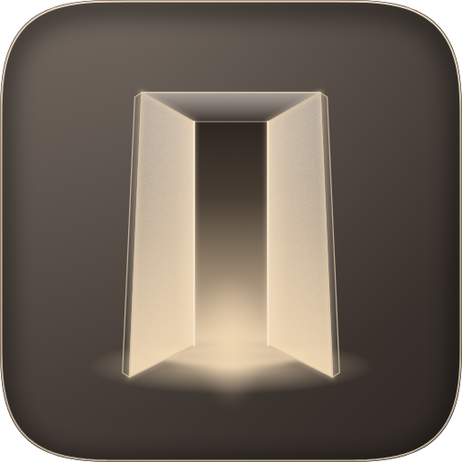

<h1 align="center">HushScreen</h1>

<p align="center">

</p>

<p align="center"><strong>A calm, cinematic web client for Jellyfin servers.</strong></p>

HushScreen is based on Jellyfin Web 10.11.11. It is not affiliated with or endorsed by the Jellyfin project. It works with Jellyfin server 10.11.x.

## Features

- **Glass theme.** A glass-material theme, Hush Glass (theme id `liquidglass`), with a full-bleed home hero and a redesigned details page.
- **Background trailers.** After you rest on a title for about 7 seconds, a muted trailer fades in place of the backdrop. This works on the details page, the home hero, and the focused card on TV layouts. Trailers stay off when reduced motion is on, when Save-Data is on, or when the browser tab is hidden.
- **Personal home rows.** Rows such as Because You Watched, Because You Liked, Top Picks for You, Highly Rated, Not Yet Watched, and New in Your Genres. They are built from your play history and the server's similar-items data.
- **Quality badges.** Badges for video and audio formats, using the official format logos. Supported formats include Dolby Vision, HDR, Dolby Atmos, Dolby TrueHD, Dolby Digital, Dolby Digital Plus, DTS, and DTS-HD Master Audio.
- **TV layout.** Layout and focus refinements for TV screens.

## Requirements

- Node.js 20 or later
- npm 9.6.4 or later, below 11
- A Jellyfin server running version 10.11.x

## Install

1. Clone the repository and install the dependencies.

   ```sh
   git clone https://github.com/kalyanreddy1009/hushscreen.git
   cd hushscreen
   npm ci
   ```

2. Build the production web client. The output goes to the `dist/` folder.

   ```sh
   npm run build:production
   ```

3. Serve the `dist/` folder as the web client of your Jellyfin server. Use one of these methods:

   - Start the server with the `--webdir` option set to the path of the `dist/` folder. See the [Jellyfin documentation](https://jellyfin.org/docs/) for how to start the server with options.
   - Or replace the web folder bundled with the server with the contents of `dist/`.

4. Open the server in a browser. Go to **Settings > Display** and choose the **Hush Glass** theme.

## Development

### Dependencies

- [Node.js](https://nodejs.org/en/download)
- npm (included in Node.js)

### Getting started

1. Clone or download this repository.

   ```sh
   git clone https://github.com/kalyanreddy1009/hushscreen.git
   cd hushscreen
   ```

2. Install build dependencies in the project directory.

   ```sh
   npm install
   ```

3. Run the web client with webpack for local development.

   ```sh
   npm start
   ```

4. Build the client with sourcemaps available.

   ```sh
   npm run build:development
   ```

5. Build the production client.

   ```sh
   npm run build:production
   ```

### Directory structure

```
.
└── src
    ├── apps
    │   ├── dashboard           # Admin dashboard app
    │   ├── experimental        # New experimental app
    │   ├── stable              # Classic (stable) app
    │   └── wizard              # Startup wizard app
    ├── assets                  # Static assets
    ├── components              # Higher order visual components and React components
    ├── constants               # Common constant values
    ├── controllers             # Legacy page views and controllers (deprecated, do not add new files)
    ├── elements                # Basic webcomponents and React equivalents (needs cleanup)
    ├── hooks                   # Custom React hooks
    ├── lib                     # Reusable libraries
    │   ├── globalize           # Custom localization library
    │   ├── jellyfin-apiclient  # Supporting code for the deprecated apiclient package
    │   ├── legacy              # Polyfills for legacy browsers
    │   ├── navdrawer           # Navigation drawer library for classic layout
    │   └── scroller            # Content scrolling library
    ├── plugins                 # Client plugins (features dynamically loaded at runtime)
    ├── scripts                 # Random assortment of visual components and utilities (deprecated, do not add new files)
    ├── strings                 # Translation files (only commit changes to en-us.json)
    ├── styles                  # Common app Sass stylesheets
    ├── themes                  # Sass and MUI themes, including the liquidglass theme
    ├── types                   # Common TypeScript interfaces/types
    └── utils                   # Utility functions
```

Most new code belongs under the appropriate app directory unless it is common or shared.

## Privacy

- Background trailers load only when a trailer is about to play. The YouTube IFrame Player API script loads from `www.youtube.com`, and the player itself loads from `www.youtube-nocookie.com`.
- HushScreen adds no other third-party requests. Its other data comes from your own Jellyfin server.

## Credits

HushScreen is built on Jellyfin Web. Thanks to the [Jellyfin contributors](https://github.com/jellyfin/jellyfin-web) and the names listed in [CONTRIBUTORS.md](CONTRIBUTORS.md).

- Upstream project: [github.com/jellyfin/jellyfin-web](https://github.com/jellyfin/jellyfin-web)

## License and trademarks

HushScreen is free software licensed under the GNU General Public License, version 2 or later (GPL-2.0-or-later). The full text is in [LICENSE](LICENSE). Source code must remain available under the same terms.

Copyright and attribution notices, and trademark notices for third-party names and format logos, are in [NOTICE](NOTICE).
